<a href="https://pdrflp.vercel.app/en?from=github">
  
</a>

<p align="center">
  <b>English</b> · <a href="./README.pt.md">Português</a>
</p>

<p align="center">
  <a href="https://pdrflp.vercel.app/en?from=github"></a>
  <a href="https://www.linkedin.com/in/pdrflp/"></a>
  <a href="mailto:pedrofelipewk@gmail.com"></a>
  <a href="https://pdrflp.vercel.app/cv/pedro-felipe-en.pdf"></a>
  <a href="https://pdrflp.vercel.app/cv/pedro-felipe-pt.pdf"></a>
</p>

## `> whoami`

Back-end developer from Fortaleza, Brazil, studying Computer Science at **UNIFOR** (5th semester, graduating 2028).

I build services that stay correct when the network drops, a message arrives twice, and two requests race for the same balance. **Java and Spring Boot** by trade, **TypeScript and NestJS** by curiosity, **PostgreSQL** as the referee.

Since I was a kid, playing on the PC, I went after what the game wasn't meant to show — getting out of the map, the wrong texture in a corner nobody looks at. Back-end is the same hunt, just with logs.

```text
experience   2024 · Eletra Energy Solutions — software development fellow
status       open to internships and junior back-end roles
where        on-site / hybrid in Fortaleza · remote anywhere
```

## `> ./start-here`

Reviewing my code? Pick the time you have:

| Time | Where to look |
| --- | --- |
| **1 min** | [Resíduo in 79 seconds](https://github.com/pdrflp0/residuo/blob/main/docs/media/residuo-intro.mp4) — the bug, the fix and the evidence, recorded from the real app |
| **5 min** | [Wagering `ARCHITECTURE.md`](https://github.com/pdrflp0/jungle-gaming-backend-challenge/blob/main/ARCHITECTURE.md) — every trade-off, and what is *not* proven yet · [Resíduo design decisions](https://github.com/pdrflp0/residuo/blob/main/docs/decisoes.md) (PT) |
| **10 min** | The code that matters: [the guarded consumer](https://github.com/pdrflp0/residuo/blob/main/apps/reference-service/src/consumers.ts) · [the verdict evaluator](https://github.com/pdrflp0/residuo/blob/main/packages/engine/src/evaluate.ts) · [3 OS processes racing for one wallet](https://github.com/pdrflp0/jungle-gaming-backend-challenge/blob/main/src/wagering/multi-instance-processes.concurrency.ts) |
| **Live** | [Reproduce the Resíduo bug in your browser](https://pdrflp.vercel.app/en/residuo?from=github), step by step, in both modes |

## `> ls ./projects --sort=impact`

<sub>Ranked by technical weight and difficulty. Each card is a service: status, real metrics and the events it actually handles.</sub>

<a href="https://github.com/pdrflp0/residuo"></a>
<a href="https://github.com/pdrflp0/jungle-gaming-backend-challenge"></a>

<a href="https://github.com/pdrflp0/portfolio"></a>
<a href="https://github.com/pdrflp0/integration_project_backend"></a>
<a href="https://github.com/pdrflp0/Minha-Cidade-Minha-Rua"></a>
<a href="https://github.com/pdrflp0/commerceops-api"></a>

<a href="https://github.com/pdrflp0/EmailUniTreino">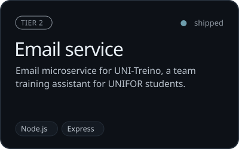</a>
<a href="https://github.com/pdrflp0/shape-2026">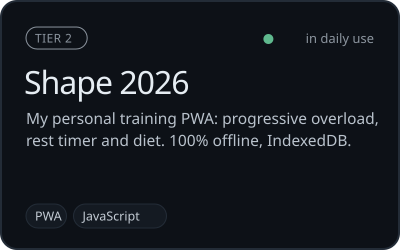</a>
<a href="https://github.com/pdrflp0/space-invaders">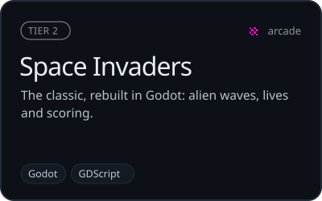</a>

## `> tail ~/bug-journal`

Short post-mortems of bugs I reproduced, fixed or hunted down:

- [**The deleted record that came back**](https://pdrflp.vercel.app/en/bugs/resurrection?from=github) — a late offline edit, an innocent upsert, and how to prove it.
- [**Two bets of 80 on a balance of 100**](https://pdrflp.vercel.app/en/bugs/double-spend?from=github) — check-then-act, `SELECT … FOR UPDATE` and the database as referee.
- [**The refund that arrived before the bet**](https://pdrflp.vercel.app/en/bugs/out-of-order?from=github) — out-of-order messages, the Outbox pattern and a test that kills the process.
- [**The test that passed without the lock**](https://pdrflp.vercel.app/en/bugs/the-test-that-lied?from=github) — testing the tests by breaking the code on purpose.

## `> cat stack.yml`


## `> ./contact`

Hiring for a back-end internship or junior role — or just want to talk about distributed systems? **[Email me](mailto:pedrofelipewk@gmail.com)** or send a message on **[LinkedIn](https://www.linkedin.com/in/pdrflp/)**. I'm happy to walk you through any of these projects in a call.

<a href="https://pdrflp.vercel.app/en?from=github"></a>
