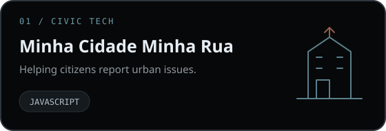
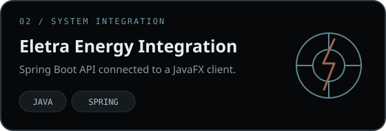
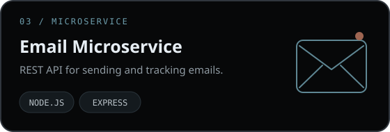
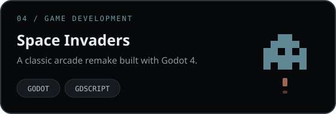
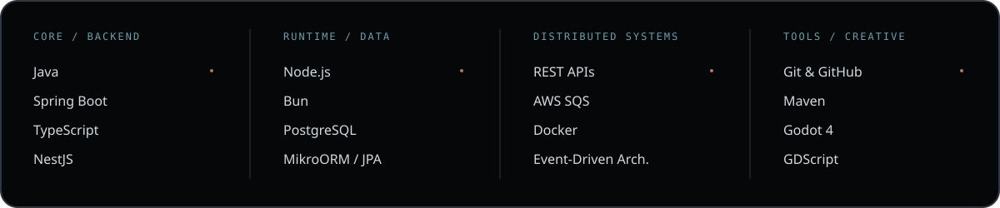

<div align="center">
  
</div>

<div align="center">
  <a href="https://www.linkedin.com/in/pedro-felipe-a71804217/">
    
  </a>
  <a href="mailto:pedrofelipewk@gmail.com">
    
  </a>
  <a href="https://www.instagram.com/pdr.flp/">
    
  </a>
</div>

<br />

## `> whoami`

I'm **Pedro Felipe**, a Computer Science student at **UNIFOR** and a backend developer from Fortaleza, Brazil. I enjoy turning requirements into reliable APIs, integrations and products that solve concrete problems.

My main path is **Java and Spring Boot**, while Node.js and game development are part of how I keep experimenting, learning and building beyond the usual stack.

```java
public final class PedroFelipe {

    private final String role = "Backend Developer";
    private final String education = "Computer Science @ UNIFOR";
    private final String location = "Fortaleza, CE — Brazil";

    private final String[] focus = {
        "Java", "Spring Boot", "REST APIs", "System Integration"
    };

    private final String hobby = "Gaming";
}
```

## `> featured_projects`

<p align="center">
  <a href="https://github.com/pdrflp0/Minha-Cidade-Minha-Rua">
    
  </a>
  <a href="https://github.com/pdrflp0/integration_project_backend">
    
  </a>
</p>

<p align="center">
  <a href="https://github.com/pdrflp0/EmailUniTreino">
    
  </a>
  <a href="https://github.com/pdrflp0/space-invaders">
    
  </a>
</p>

## `> tech_stack`

<div align="center">
  
</div>

## `> beyond_code`

Outside development, gaming is my main hobby.

<div align="center">
  <br />
  <sub><strong>pdrflp · Fortaleza, CE · Brazil</strong></sub>
</div>
