<a href="https://pdrflp.vercel.app/pt?from=github">
  
</a>

<p align="center">
  <a href="./README.md">English</a> · <b>Português</b>
</p>

<p align="center">
  <a href="https://pdrflp.vercel.app/pt?from=github"></a>
  <a href="https://www.linkedin.com/in/pdrflp/"></a>
  <a href="mailto:pedrofelipewk@gmail.com"></a>
  <a href="https://pdrflp.vercel.app/cv/pedro-felipe-pt.pdf"></a>
  <a href="https://pdrflp.vercel.app/cv/pedro-felipe-en.pdf"></a>
</p>

## `> whoami`

Desenvolvedor back-end em Fortaleza, CE, estudante de Ciência da Computação na **UNIFOR** (5º semestre, formatura em 2028).

Construo serviços que continuam corretos quando a rede cai, a mensagem chega duas vezes e dois pedidos disputam o mesmo saldo. **Java e Spring Boot** de ofício, **TypeScript e NestJS** por curiosidade, **PostgreSQL** como árbitro.

Desde criança, jogando no PC, eu ia atrás do que o jogo não queria mostrar — sair dos limites do mapa, a textura errada num canto onde ninguém olha. Back-end é a mesma caçada, só que com logs.

```text
experiência  2024 · Eletra Energy Solutions — bolsista em desenvolvimento de software
status       aberto a estágio e vagas júnior de back-end
onde         presencial / híbrido em Fortaleza · remoto de qualquer lugar
```

## `> top -u pdrflp0`


## `> ./comece-aqui`

Vai avaliar meu código? Escolha o tempo que você tem:

| Tempo | Onde olhar |
| --- | --- |
| **1&nbsp;min** | [O Resíduo em 79 segundos](https://github.com/pdrflp0/residuo/blob/main/docs/media/residuo-intro.mp4) — o bug, a correção e a evidência, gravados do app real |
| **5&nbsp;min** | [Decisões de projeto do Resíduo](https://github.com/pdrflp0/residuo/blob/main/docs/decisoes.md) · [`ARCHITECTURE.md` do Wagering](https://github.com/pdrflp0/jungle-gaming-backend-challenge/blob/main/ARCHITECTURE.md) — cada trade-off, e o que *ainda não* está provado |
| **10&nbsp;min** | O código que importa: [o consumidor protegido](https://github.com/pdrflp0/residuo/blob/main/apps/reference-service/src/consumers.ts) · [o avaliador do veredito](https://github.com/pdrflp0/residuo/blob/main/packages/engine/src/evaluate.ts) · [3 processos do SO disputando a mesma carteira](https://github.com/pdrflp0/jungle-gaming-backend-challenge/blob/main/src/wagering/multi-instance-processes.concurrency.ts) |
| **Ao vivo** | [Reproduza o bug do Resíduo no navegador](https://pdrflp.vercel.app/pt/residuo?from=github), passo a passo, nos dois modos |

## `> ls ./projetos --sort=impacto`

<sub>Em ordem de peso técnico e dificuldade. Cada card é um serviço: status, métricas reais e os eventos que ele de fato processa.</sub>

<a href="https://github.com/pdrflp0/residuo"></a>
<a href="https://github.com/pdrflp0/jungle-gaming-backend-challenge"></a>

<a href="https://github.com/pdrflp0/portfolio"></a>
<a href="https://github.com/pdrflp0/integration_project_backend"></a>
<a href="https://github.com/pdrflp0/Minha-Cidade-Minha-Rua"></a>
<a href="https://github.com/pdrflp0/commerceops-api"></a>

<a href="https://github.com/pdrflp0/EmailUniTreino">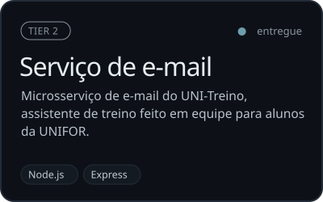</a>
<a href="https://github.com/pdrflp0/shape-2026">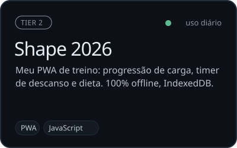</a>
<a href="https://github.com/pdrflp0/space-invaders">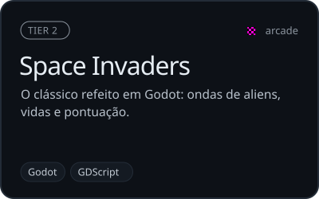</a>

## `> tail ~/diario-de-bugs`

Post-mortems curtos de bugs que eu reproduzi, corrigi ou cacei:

- [**O registro que voltou dos mortos**](https://pdrflp.vercel.app/pt/bugs/resurrection?from=github) — uma edição offline atrasada, um upsert inocente e como provar isso.
- [**Duas apostas de 80 num saldo de 100**](https://pdrflp.vercel.app/pt/bugs/double-spend?from=github) — check-then-act, `SELECT … FOR UPDATE` e o banco como árbitro.
- [**O reembolso que chegou antes da aposta**](https://pdrflp.vercel.app/pt/bugs/out-of-order?from=github) — mensagens fora de ordem, o padrão Outbox e um teste que mata o processo.
- [**O teste que passava sem a trava**](https://pdrflp.vercel.app/pt/bugs/the-test-that-lied?from=github) — testar os testes quebrando o código de propósito.

## `> cat stack.yml`


## `> ./contato`

Tem uma vaga de estágio ou júnior em back-end — ou só quer trocar uma ideia sobre sistemas distribuídos? **[Me mande um e-mail](mailto:pedrofelipewk@gmail.com)** ou uma mensagem no **[LinkedIn](https://www.linkedin.com/in/pdrflp/)**. Topo apresentar qualquer um desses projetos numa conversa.

<a href="https://pdrflp.vercel.app/pt?from=github"></a>
